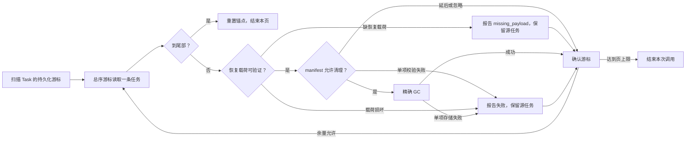

# 架构

## 一句话

**一个通用的 RAG 框架，同时是库和参考服务。** 库那一半（`engines/`）只依赖
pydantic/httpx/lxml 一类的纯计算包；服务那一半在它之上加了任务调度、持久化
与 HTTP 接口。两半共用同一份解析与切分代码。

## 分层

```
    composition/    组合根：把配置装配成一整套资源  ┐
    api/            HTTP 入口（FastAPI）          ├─ 参考服务
    workers/        消费端进程（arq）             ┘
        ↓
    services/       用例编排（Pipeline、入库、检索、知识库）
    api/schemas/    HTTP 请求/响应 DTO
        ↓
    tasks/          通用任务框架、契约与参考实现
    infrastructure/ 来源、模型、提取、持久化与队列适配器
        ↓
    engines/        纯计算：文档处理、切分、融合、排程
        ↓
    ports/          契约（Protocol / ABC）与值对象         ┐
    core/           闸门、降级、日志、时间 —— 人人依赖       ├─ 零依赖地基
    config/  exceptions/                                    ┘
```

依赖方向**只能向下**。`tests/unit/test_layering.py` 用 AST 检查以下边界：

1. `engines/` 不得 import 任何基础设施包（redis / pymilvus / sqlalchemy /
   arq / fastapi …）。破了这条，用户为了跑一个 docx 解析器就得装一整套中间件，
   "库"这一半当场作废（spec A1）。
2. `engines/` 只能 import `engines` 与 `ports`（**白名单**）。
3. `services/` 不得 import `infrastructure/`；模型和向量存储适配器另有专门
   守卫。具体供应商只在组合根选择。
4. `ports/` 只能依赖标准库与自身，不能反向依赖使用者或适配器。
5. `core/` 不得 import 本项目任何其他包。它是人人依赖的零依赖内核，
   一旦回头依赖上层就出环。
6. 顶层包之间不得成环。环里的包无法被单独理解或单独拿走。
7. 单进程路径不得 import `workers.maintenance`（租约回收），理由见下文「崩溃恢复」。
8. 服务具体模型只能在 `composition/bootstrap.py` 构造，模型定义模块除外。
   绕开组合根会漏绑进程级闸门。
9. engines 的模块级并发默认值集中在 `engines/defaults.py`，避免调用处各自发明预算。

第 2 条原本是一份黑名单（禁止 api / workers / services）。黑名单只拦得住
已经想到的那几个包：后来新增的 `application/` 就从缝里溜了进去，`pipeline.py`
运行时 import 了它，而本文档白纸黑字写着 engines 在最底层。**文档说的规则
和守卫执行的规则不是同一条，中间差出的那个洞刚好够放一个错误。** 改成白名单
之后没有这个失效模式：新包默认被拒。

### 为什么 `ports/` 在最底层

契约必须比所有使用者都低，否则使用者就得向上依赖。`engines/` 需要说出
"我要一个 embedding 模型"；如果契约住在某个上层包里，engines 就只能反向依赖 ——
这正是上面第 2 条要防的事。`ports/` 不 import 本项目任何其他包，所以谁依赖
它都是向下。`ports/` 内部可以复用自身的契约和值对象；除此以外只依赖标准库。

值对象（`MediaResource`、`RerankDocument` …）也放在 `ports/`：它们是 Port
签名里出现的类型，也就是这套契约的词汇表。

`DocumentExtractorPort` 也遵循这条规则：它只接收 Loader 已经落地的受管本地文件，
返回 `ExtractedDocument`，不认识 URL、S3 凭据、MinerU backend 或 HTTP 响应。
所有结果在进入文档级 `ChunkingStrategy` 前由 `engines/documents/normalization/`
转换成 `NormalizedDocument`。规范化后的 Markdown 由
`engines/documents/markdown/` 识别标题 section，结构事实用 `DocumentBlock` 的字符
span 表示；`MarkdownSectionStrategy` 或 `PageChunkingStrategy` 再在每个硬边界内调用
原子 `Chunker`，不会重新猜标题或页面。
`AsyncMinerUDocumentExtractor` 是 `infrastructure/extractors/`
中的外部适配器，只有 `composition/` 能把它注册成 PDF Pipeline Hook。

### 组合根的配置合并

`composition/pipeline_config.py::resolve_pipeline_config` 只接收部署 `LimitsConfig`
和可选的调用方 `PipelineConfig`，计算有效配置，不创建资源。覆盖顺序是调用方显式值、
部署默认值、库默认值；即使显式值恰好等于库默认，也保留该覆盖。嵌套 DOCX 字段单独
判断是否显式设置，注入的模型对象保持身份，调用方配置不被修改。

合并后重新校验顶层和 DOCX 字段，拒绝构造后被赋成非法值的配置；同时保留
PipelineConfig 子类的约束和注入模型身份。

`await build_context(...)` 在创建资源之前重校验 APPConfig、合并 PipelineConfig、
检查实际所选后端的连接配置。它负责资源选择、共享闸门和装配；配置推导与资源
生命周期分别有可独立阅读和验证的入口。

### 组合根的资源所有权

初始化失败只回收本次成功创建的资源，按创建逆序等待清理完成，再传播启动错误。
注入对象此时仍归调用方；闸门绑定会修改注入对象，失败不恢复原闸门。
完整返回 Context 后，包含注入对象在内的资源交给 Context 托管。
模型、来源和外部提取器的同步/异步实例只创建各自模式的客户端；单个对象不再同时持有两套连接池。

正常关闭先排干执行器，再撤销 runner / Hook 引用，随后关闭 Loader、Extractor、
向量/文档存储和模型，最后关闭自建数据库。单项清理错误记录日志并继续，重复或并发
`close()` 共享同一次清理；调用方取消也要等待清理结束。启动回滚只按身份撤销本次
新增的 runner；成功后的 Context 关闭会清空自己的注册表，释放显式替换的 runner 引用。

API 和 worker 只在创建成功后发布 Context，关闭前撤销自己发布的引用。
任务 runner 由显式 `RunnerRegistry` 持有，执行器默认各建一份，`Context.runners`
与自带执行器共享同一实例。多个 Context 可在同进程独立装配；执行和 ARQ 续跑道次
判断都只读各自的注册表，没有全局兜底。外围模型、Loader、存储也必须独立持有，
共享同一个资源对象不属于这种隔离保证。重复向一个执行器装配入库 runner 会明确报错。
注入自定义 TaskExecutor 时必须显式提供 `runners=`，由其消费实现使用；仅向外部队列
投递的实现由外部消费者独立装配注册表。自带执行器与显式注册表不一致时在创建资源前拒绝。队列载荷与 TaskExecutor 抽象方法保持不变。

## 执行模式与共享计算

需要同时面向同步和异步调用者的适配器、Pipeline、Loader 与 HookRegistry 分成
`Foo` / `AsyncFoo`。两边的方法同名：`run`、`embed_query`、`rank`、`extract`、
`load`、`close`；异步调用者显式等待。对应 Port 也分离，组合根只选择服务使用的
异步实现。`PipelineHooks` 与 `AsyncPipelineHooks` 是两个默认注册表实例，Context
从异步表 `fork()` 得到独立快照。

共享部分保留为同步计算：请求 DTO、输入规范化、响应解析、排序、分块器、DOCX Parser
与值对象不因调用方式增加一份 Async 算法。异步编排在必要处将同步文件读取、DNS、
ZIP/XML 解析交给 `engines.offload.run_sync`；取消时等待工作线程结束后才传播，防止
调用方提前释放输入资源。入库 IngestRunner 的正规化、分块和 LoadedResource.cleanup
同样使用这条边界：阶段退出或 Task 落取消终态之前，已启动的同步工作必须结束；
临时文件清理也在工作线程执行，避免阻塞事件循环。线程不能被强制终止，此处也不承诺
CPU 吞吐扩容。

上游有原生异步 API 时直接使用：HTTPX、OpenAI、aioboto3、SQLAlchemy/asyncpg、
ARQ/Redis 与 PyMilvus 均如此。`AsyncMilvusStore` 只持有 `AsyncMilvusClient`；
集合与索引管理也已使用原生异步接口。SDK 惰性连接，构造 Context 成功不等于 Milvus
可达；连接错误在首次等待的 RPC 暴露。

`TaskStore`、`TaskExecutor`、`DocumentStore`、`KnowledgeBaseRepository`、
`RevisionStager` 本来只有异步操作，保留领域类型名，方法移除 `a` 前缀；不创建同步
副本。Gate 刻意维持双模式：同步与异步实例必须竞争同一进程级预算，不能分成两份限额。
详见 [V2 异步能力复核](../tasks/v2_async_reassessment.md)。

## 核心抽象

每一个都配有一套**与实现无关的契约测试**（`tests/contracts/`）。
两种向量存储共同遵守 [Filter 契约](filter_semantics.md)，字段等值/标量 IN 的类型、
空值与安全数值范围由 ports/filtering.py 统一定义，不由各适配器分别猜测。
换实现时跑同一套契约，这是"换后端行为不变"这句承诺的唯一兑现手段 ——
不是靠文档，是靠契约断言。

| 抽象 | 内存实现 | 真实实现 | 契约源 |
|---|---|---|---|
| `TaskStore` | `InMemoryTaskStore` | `PostgresTaskStore` | [task_store.py](../tests/contracts/task_store.py) |
| `TaskExecutor` | `InProcessExecutor` | `ArqExecutor` | [task_executor.py](../tests/contracts/task_executor.py) |
| `AsyncVectorStore` | `AsyncInMemoryVectorStore` | `AsyncMilvusStore` | [vector_store.py](../tests/contracts/vector_store.py) |
| `AsyncKeywordSearchPort` | `AsyncInMemoryVectorStore` | `AsyncMilvusStore` | [keyword_search.py](../tests/contracts/keyword_search.py) |
| `DocumentStore` | `InMemoryDocumentStore` | `PostgresDocumentStore` | [document_store.py](../tests/contracts/document_store.py) |
| `KnowledgeBaseRepository` | `InMemoryKnowledgeBaseRepository` | `PostgresKnowledgeBaseRepository` | [knowledge_base.py](../tests/contracts/knowledge_base.py) |

表中链接指向共享契约基类；参数化后的用例数量应以具体实现的 `pytest --collect-only`
结果为准，不在文档维护另一份计数。

向量与文档存储负责 metadata 的所有权：写入调用完成后，修改输入不影响已存数据；
每次读取返回独立快照，修改嵌套字典或列表不影响后续读取及其他结果。调用尚未完成时，
调用方不应并发修改输入。内存实现必须显式复制，不能依赖真实后端的序列化边界。
内存批量写入先完成校验和全部快照，再发布，避免复制失败留下半批数据。
`RevisionDraft` / `StoredParent` 构造时也隔离 metadata；只有最外层只读，内部仍保持
JSON 风格的 dict/list，不能把 frozen dataclass 当作递归不可变对象。

`DocumentStore` 只保存 revision manifest 与不参与召回的父块正文。PostgreSQL 的 active
pointer 是版本可见性的唯一真相；清理 retired/abandoned revision 时保留 `purged`
manifest 墓碑，避免旧任务在 GC 后重新申请更高 generation 并覆盖新版本。Milvus 子向量
及读写编排不属于 Store 自身职责。

M4 当前已有 `HierarchyBuilder`（`engines/indexing/`）、`IndexPlanner`/`RevisionStager`
（`services/indexing.py`）、有界 Task context 移交，以及 revision-aware 召回和父块回填。
Stager 只写到 ready；`RevisionActivator` 复用 Store 的幂等 reserve、原子激活与 generation
围栏，`RevisionTaskStages.activate` 作为独立阶段从同一 manifest 恢复。激活响应丢失时
识别 already-active；已被更高 generation 替换时返回 superseded，不重新准备或覆盖。
版本顺序以 Store reserve 分配的 generation 为准，不以 Task 创建时间推断。
网络异常和取消不证明提交失败，禁止据此清理向量或回滚 active。尚未发布的旧 generation
保持 ready，由独立 GC 显式登记废弃；已发布的 retired/purged manifest 保留恢复证据。
`RevisionGarbageCollector.collect_superseded` 接受 Activator 的 superseded 结果，先原子
abandon（拒绝 active），再按 KB/source/revision 删除向量并核验剩余数为零，最后清父块
并保留 purged 墓碑。删除、计数或父块事务失败保留候选，重试删除零行也算成功。
`sweep(limit=32)` 单次只处理一批 retired/abandoned；单项失败记录并继续，取消继续传播。
登记提交前失败的 ready 不在扫描队列里，调用方必须重试登记。独立 Task 阶段已持久化
发布结果和 GC 意图。独立对账可显式配置由 IO worker 定时触发，生产
`IngestRunner` 仍未切换；旧数据/写入迁移仍需验收。读侧可显式配置或注入
DocumentStore，默认关闭。M4 的完整完成标准见 `tasks/m4_todo.md`，不能由切片通过推定。

### revision 任务恢复协议

第十九批在 reserve/写父块之前先保存 `revision_prepare`（version + RevisionDraft），
绑定原任务、revision 和完整计划指纹，不保存父块正文或向量。父块完成后，一次 CAS
保存完整 handoff、清空准备意图并释放原文；写父块或确认失败保留恢复身份与重建输入。
FAILED 可重试同一计划；CANCELLED 则可凭准备意图精确回收部分写入，不必等完整 handoff。
旧记录既无 handoff、也无准备意图时仍保留并告警，不能事后猜测计划。

`RevisionTaskStages` 的发布阶段显式注入 `document_store=`，清理另注入
`garbage_collector=`。Task context 中的 `revision_publication` 是版本 1 的窄记录：
revision key、plan 指纹、task_id、generation、phase；不复制父块正文或向量。
所有写入经过 `put_bounded`，整份 context 继续受 32 MiB 限制和任务所有权围栏约束。
阶段入口从幂等 reserve 复验计划/任务身份、generation 和 manifest 事实。

| phase | 已持久化的含义 | 恢复动作 |
|---|---|---|
| `activating` | 已登记发布意图，结果尚未确认 | 重试原 manifest 的激活，不重新 embedding；不能据此执行 GC |
| `active` | 曾观察到该版本激活成功 | 重新核验 manifest；已被替换则先保存 cleanup_pending，再清理 |
| `cleanup_pending` | 已得到 superseded 结果，必须清理本 revision | 原子 abandon、精确删除、零残留核验、purge，最后保存完成回执 |
| `cleanup_complete` | 上次清理已完成，保留精确身份 | 显式重放时仍执行删除与核验，不能直接跳过 |

`activate(ctx)` 与 `cleanup(ctx)` 是独立 StagePipeline 阶段，不共用“失败回滚激活”的
处理器。激活提交后结果写回失败，保留 activating 并恢复 Store 的事实；abandon/purge
或 Task 确认响应丢失时保留原身份，重试不能重新 stage 或分配新 generation。
进入发布恢复后 `stage(ctx)` 明确拒绝重写。阶段边界的取消/租约丢失会停止后续 IO，
但已提交的 active、abandoned 或 purged 不会被回滚。

**迟到 upsert 是跨库边界。** 已发出的旧请求可能在 GC 之后落入 Milvus；它不通过
revision-aware 可见性检查，但 purged 不在普通 sweep 候选里，因而仍会占用存储。
`collect_inactive(key)` 复用既有 Store 原语提供精确补偿，active 保护仍早于任何向量 IO。
清理成功仅证明本次核验时为空，不能证明未来不会再落库。生产开启前必须落实旧写
排干或持续对账、Task 意图保留与分页扫描；删除 Task 后不能再依赖其意图恢复。
第十七批未自动注册补偿扫描、修改候选状态集合或增加 Task/schema 字段；
第十八批的对账与删除约束如下。

### 持续对账与任务保留

第十八批经确认最小扩展 TaskStore：`TaskCursor(created_at, task_id)` 与
`list_tasks_before` 提供排他倒序页；`delete` 支持 guard 和 expected_version，底层删除
带版本条件，冲突重读时复验守卫。guard 必须是依赖版本化字段的纯函数；心跳不涨版本，
不能用它证明 GC 身份可以释放。其余 Store Port、Task 字段与 schema 不变。

组合根向 TaskService 注入 `guard_revision_task_deletion`，保留 revision 身份、回执和
扫描游标；终态、年龄与 complete 都不是删除许可，force 也不绕过。底层未传 guard 的
Store.delete 仍是通用/特权原语，不能用于应用 TTL 清理。任务内核不认识业务 context 键。

`RevisionReconciler.run_page` 接收带 worker/attempts 围栏的扫描 TaskContext。默认每页
8 条、最多 32 条、30 秒工作预算，逐条查询 limit=1，避免多份大 context 同时驻留。
4 KiB 有界扫描 context 保存 kind/游标版本与锚点；处理后才确认位置。单项失败报告并
保留源记录供下一轮重访，查询/确认失败、超时、取消或租约丢失向上传播。到尾部重置
游标即结束调用，不在一次运行中循环扫空。这不是 MVCC 快照。



对账不发布版本、不修改源任务，也不把 FAILED 的 staging/ready 擅自废弃。准备意图可
覆盖移交前取消；缺两种载荷的终态历史任务单列 missing_payload，完整载荷损坏列为 failed。
二者都保留源记录且不猜测 GC，并发激活仍由 Store 原子保护。

第十九批新增 `RevisionMaintenance`：同一来源 kind 幂等复用一个持久化游标 Task，
绑定向量存储命名空间摘要；每次触发以版本 CAS 认领，唯一 owner/单调 attempts 围栏
释放。成功回到 PENDING，失败落 FAILED，下次触发继续原游标；显式取消不自动复活。
维护 Task 不进入业务队列，普通 PENDING 补投排除其 kind。它复用 TaskStore 原语，
不改变状态机，也不创建另一套队列或后台工作流。
应用 TaskService 另按本 Context 当前注册的业务 kind 统计 backlog，过滤早于分页上限；
保留的维护游标不消耗业务容量。通用门面未传范围回调时仍保持原全局 PENDING 计数。

自动调度默认关闭，仅明确配置的 ARQ/PostgreSQL/Milvus 组合开启。仅 IO worker
每分钟第 23 秒及启动时触发一页，页工作预算 30 秒、cron 外层 45 秒；失联复用既有
90 秒租约回收。单进程不挂维护；启用对账不会顺带打开 revision 读取或切换生产写入。
`/admin/limits` 暴露维护状态、最近页和 180 秒无确认页进度的 overdue，配合稳定日志
事件告警；心跳不能掩盖无进展。完整策略、暂停/取消边界和剩余生产门禁见
[对账设计](../tasks/v2_reconciliation_design.md)。


### 迁移前的 API 入库暂停

组合根把 `ingest_policy.accept_new_tasks` 放入 Context，API 的新入库与手动 ingest
重试共用准入检查。关闭时在来源 IO/任务写入之前返回 503；执行器仍处理已受理任务，
状态、读取和取消不依赖该开关。通用 TaskService/Executor 不认识迁移策略，低层调用
不受 API 开关约束。该控制不能证明旧进程或远端 RPC 排干。
新命名空间重建与后续生产阶段接线见 [迁移边界](revision_migration.md)。


Milvus 的计数和删除 ID 选择固定使用 Strong，检索仍保留配置的一致性偏好；跨客户端
旧快照不能作为 GC 完成依据。这使用上游已有的 query 参数，见
[Milvus 2.6 query 一致性文档](https://milvus.io/api-reference/pymilvus/v2.6.x/MilvusClient/Vector/query.md)。

### 检索边界

检索侧刻意把完整存储生命周期与只读能力分开：`AsyncVectorSearchPort` 只暴露 dense
召回，`AsyncKeywordSearchPort` 只暴露关键词召回。`RetrievalService` 按请求选择一路或
并发调用两路，hybrid 的原始分数不直接相加，而是在 `engines/retrieval/` 用纯 RRF
按名次融合。这样 Milvus 的表达式、BM25 index 与 consistency level 都不会穿透 Port。

两路各自最多返回 `fetch_k` 条，因此去重前最多有 `2 × fetch_k`（当前上限 1000）
个候选进入 RRF；去重后的全部候选会送给 reranker。调大 `fetch_k` 会同时增加 Milvus
返回量和重排成本，不是免费的精度旋钮。关键词契约只保证后端行为语义一致：内存实现
的轻量 tokenizer 与 Milvus chinese analyzer 不承诺相同分词或相同 BM25 分数。

hybrid 单路出现可恢复故障时只降级该路；schema、维度、知识库与请求参数错误仍直接
失败；revision 判活失败也必须拒绝整次查询。不可降级的通道失败会取消并排干另一通道，
不会等待其正常请求完成；调用方取消或重复取消同样等待子任务清理完毕。两路均出现
可恢复故障时返回 503。共享查询预算耗尽且无成功通道时返回 504；
有成功通道时保留该路，后续重排/父块只能消费剩余预算。预算覆盖模型排队与
revision 判活，取消后仍排干，具体边界见[查询 deadline](query_deadline.md)。

重排位于融合之后，服务在降级边界内校验返回结构、完整整数索引和有限分数。失败时
返回原召回/融合候选并留下结构化诊断，取消则传播。输入 metadata 使用独立快照，
重排器修改输入后失败也不会污染原候选；有效结果按索引匹配原候选，以 `replace`
仅更新分数，保留各路分数和排名。

适配器基类的同步/异步 `score()` 还会在直接返回前检查全部分数，非法值抛 ValueError；
`rank()` 复用该入口，在排序与截断前完成检查。这不替代服务校验，因为独立实现的 Port
可以绕过基类。供应商输入转换留在适配器，候选排列和降级仍归服务负责。

父块回填分开处理批量读取与纯结果物化。查询 parent_id 可以预先去重，但必须逐项验证
父块的 ID、KB、source 和 revision 后，才去重成功回填的父块；无法回填的 child 各自保留。
完整排序候选处理完毕后才截取 top-k，避免重复父块耗尽名额或坏引用抢占合法结果。

### 为什么 store 与 executor 是分开的

`TaskStore` 回答"这个任务现在怎么样了"（持久、可查询）；
`TaskExecutor` 回答"接下来谁该干活"（短暂、消费即消失）。

合成一个的话，要么队列变得不可查询，要么数据库被当成高频争抢的队列用。
更直接的理由：`spawn(task, coro)` 收的是协程对象，Redis 里没地方放协程 ——
一旦把它写进"换实现时签名不变"的接口，这句承诺就是假的。

拆开之后，**队列里只放 `task_id`**，任务数据一律回库读。于是「重试」
「崩溃恢复」「断点续跑」「跨 worker 移交」全都退化成同一个动作 `submit(task_id)`。

## 任务的一生

```
PENDING ──► RUNNING ──┬─► SUCCEEDED
   ▲         │        ├─► FAILED ──► PENDING（人工 retry）
   │         │        └─► CANCELLING ──► CANCELLED
   └─────────┴ 可重排队（可重试失败 / 租约回收 / 换道移交）
```

状态只能经 `TaskStore.transition()` 改，守卫是一张手写的迁移表
（`tasks/states.py`）。乐观锁 CAS 保证并发写不丢更新；
调用方**没传** `expected_version` 时冲突会自动重读重来，
传了才把冲突抛给它 —— 这个区分是跨进程部署逼出来的（见 `store.py::_cas`）。

## 两种部署形态

### 单进程（开发、小规模）

```
comet-rag serve      # API + InProcessExecutor，任务在本进程的协程里跑
```

不需要 Redis，不需要 worker。分道信息被忽略，整条流水线一口气跑完。

### 跨进程（生产）

```
comet-rag serve                 # 只投递，不执行
comet-rag worker preprocessor   # CPU 密集：解析 / 清洗 / 分块
comet-rag worker embedder       # IO 密集：向量化 + 写库
```

**worker 按负载特征分，不按业务名词分。** 判据只有一条：这类活该怎么扩容。

| | 负载 | 扩容方式 | 默认并发 |
|---|---|---|---|
| preprocessor | CPU 密集（GIL 挡着） | **加进程**（副本 ≈ 核数） | 2 |
| embedder | IO 密集（等回包） | **加并发**（调 max_jobs） | 32 |

反过来会真的更慢：给 embedder 加进程会把对模型服务的连接数乘以进程数，
请求在服务端排队，而每个进程只看到"上游变慢了"，看不出是自己造成的。

流水线在 `chunking` 与 `indexing` 之间**移交**：任务退回队列、带上
`resume_stage`、投到另一条道。移交复用的正是断点续跑那套机制 ——
两者在实现上是同一件事，区别只在原因。

## 崩溃恢复

worker 被 `kill -9` 时，库里那条任务会永远停在 RUNNING：没人推进、没人报错。
所以跨进程部署必须挂租约回收（`workers/maintenance.py`）：心跳超过 lease
（90s，是心跳间隔的 9 倍）就判定 worker 已死，退回队列。

**单进程模式绝不能挂** —— 那时协程还活在本进程里，回收会造出"一份任务两个
执行者"。保证方式不是开关（会被配错），而是结构：`sweep_cron` 只在 `workers/`
下注册，单进程部署根本不加载那个包，且有 AST 守卫盯着。

租约判死做不到准确（"没心跳"和"死了"分不清），所以执行器侧还有一道**围栏**：
写终态前确认任务还归自己管，被接管了就一个字都不写。
**lease 负责少误判，围栏负责误判了也不出错**，两者缺一不可。

## 资源治理

```
                        ┌── 模型闸门（embedding 与 rerank 共用）
POST /ingest ─► 积压上限 ─┼── Loader 闸门（文件描述符与外部连接）
                        ├── MinerU 闸门（外部文档解析服务）
                        └── 降级：关 rerank → 降 top_k → 拒新任务
```

**闸门同时管同步与异步。** 预算是 `threading` 原语，两侧共用一份计数 ——
`asyncio.Semaphore` 只有协程侧能拿，同步路径必然漏出去（实测配置写 4、
真实并发 16）。等待不占线程：一条 FIFO 队列里同时装同步等待者（Event）与
异步等待者（Future），取消只是把自己摘掉。

**闸门按资源分，不按模块分。** embedding 与 rerank 共用一个（抢的是同一块
GPU）；加载另配一个（护本机文件描述符与对外连接）；MinerU 再单独一个（护外部
解析服务）。混用会让"调大加载并发"意外挤掉模型或 PDF 解析名额。

**闸门必须是进程级的。** 曾经是"每次调用建一个信号量"，于是 32 个任务各开
4 路扇出 = 对模型服务 128 路并发，而配置写的是 4，监控上完全看不出来。

闸门做在适配器基类的**模板方法**里：同步/异步类各自的 `embed` / `embed_media` / `embed_batch`
都标了 `@final`，子类只能实现下面那层 `_embed` / `_embed_media` /
`_embed_batch`。于是"绕过闸门"在类型层面就没有写法。

之所以不用"包一层 wrapper 再让大家都走 wrapper"：那只是**约定**，谁直接调
底层都能绕过去，而且不报错 —— 闸门是静默失效型的保护，约定挡不住它。

`services/` 只依赖 Port 和共享值对象，不再直接依赖 `infrastructure.models`。
具体的 Qwen/OpenAI 类只在组合根中选择并装配；这让模型实现可以替换，而查询、
入库和重排用例不需要认识供应商请求字段。

所有队列都有界：闸门外的等待席位、等待时长、待执行任务数，任一越界都
**明确拒绝**（HTTP 429），不静默排队。

## 相关文档

- [目录结构与核心流程](structure.md) —— 东西放在哪、一次请求怎么走完（含依赖图与流程图）
- [部署](deployment.md) —— 两条路径的具体命令与配置
- [性能基线](benchmark.md) —— 数字的定位与采集方式
- [Pipeline 用法](pipeline_usage.md) —— 只当库用时看这个
- [docx 解析内幕](docx_parser_internals.md)
- [MinerU 集成](mineru_integration.md) —— M2
