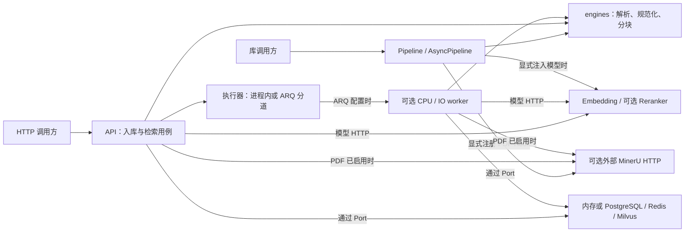
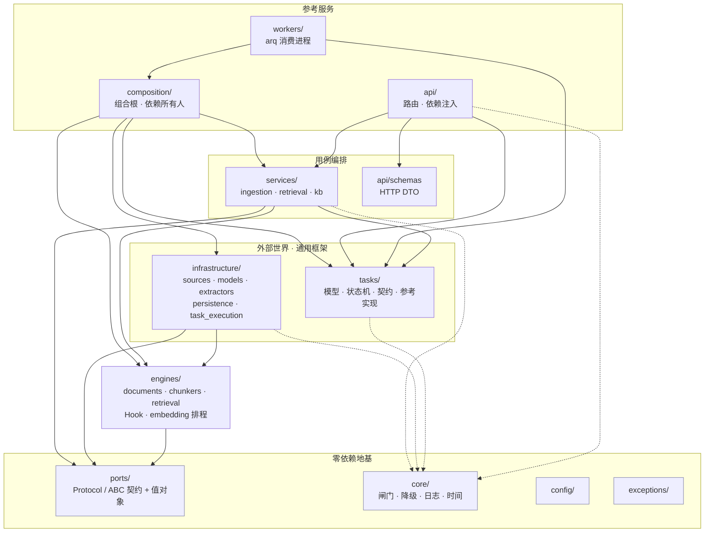
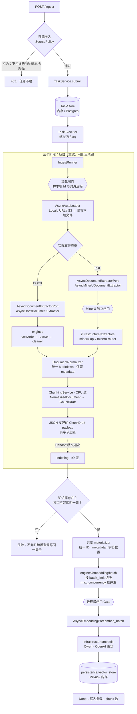
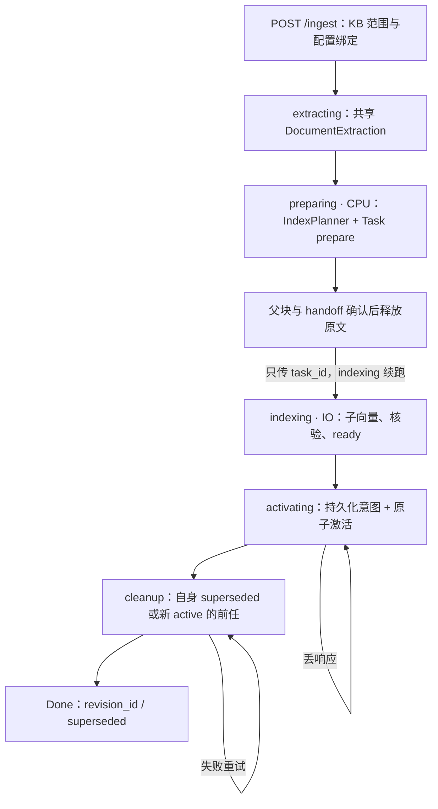
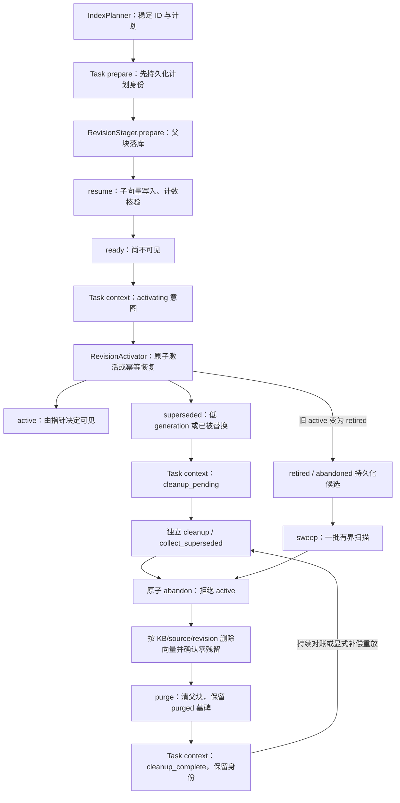
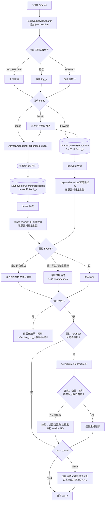

# 目录结构与核心流程

本文回答两个问题：**东西放在哪**，以及**一次请求怎么走完全程**。

模块图概括源码中的主要依赖关系，不穷举每条 import；完整边界由 AST 守卫检查。
系统边界图画运行时调用，流程图画数据/控制流，不将不同含义的箭头混在一张图中。
历史接缝见文末。下一步计划只在 [v2_next_steps.md](../tasks/v2_next_steps.md) 维护。

交互浏览见 [架构图](diagrams/comet-rag.html)，图源和更新步骤见
[维护说明](diagrams/README.md)。图由 Archify 从固定代码提交生成并核验源码证据；
生成器不作为项目运行时依赖，未提交代码或待接线路径不能画成当前生产能力。

## 系统边界

库入口是嵌入调用方进程的 Python API，不是一个独立部署的服务。参考服务按配置选择
内存实现或外部适配器；下图中的“通过 Port”是运行时调用，不是 services 导入数据库 SDK。



## 目录

```text
comet_rag/
├── pipeline.py         库用户便捷入口；只在这里装配默认 Loader
├── loaders/            Loader 稳定公共门面（S3 惰性导出）
├── api/                FastAPI 入口
│   ├── routes/         ingest · search · kb · tasks · admin
│   └── schemas/        仅 HTTP 请求/响应 DTO
├── workers/            arq 消费进程；按 CPU / IO 负载分道
├── composition/        服务组合根与长生命周期 Context
├── services/           用例、策略编排与 Pipeline；IndexPlan 物化、revision 写入/判活
├── tasks/              通用任务内核、契约与无外部依赖参考实现
├── infrastructure/     所有外部适配器
│   ├── sources/        Local · HTTP · S3 · 同步/异步 AutoLoader
│   ├── extractors/     MinerU HTTP 文档提取
│   ├── models/         embedding · reranker · vision
│   ├── persistence/
│   │   ├── sql/        SQLAlchemy 会话与 ORM
│   │   ├── vector_store/ Milvus · 内存
│   │   ├── task_store/ PostgreSQL TaskStore
│   │   ├── knowledge_base/ PostgreSQL · 内存 Repository
│   │   └── document_store/ revision manifest · 父块正文（PostgreSQL · 内存）
│   └── task_execution/ ARQ / Redis 执行适配器
├── engines/            纯计算算法
│   ├── documents/
│   │   ├── formats.py  文件格式与解析配置
│   │   ├── common/      ZIP 等跨格式文档基础能力
│   │   ├── markdown/    标题、代码围栏与 section span 分析
│   │   ├── normalization/ 跨格式 Markdown 规范化
│   │   └── docx/       converter · parser · formatting · cleaner · extractor · OMML
│   ├── chunkers/       原子 Chunker · 参数画像
│   │   └── strategies/ Markdown section · 真实页面组合策略
│   ├── embedding/      批量排程，不发模型请求
│   ├── indexing/       HierarchyBuilder 纯父子块计算，不生成存储 ID
│   ├── retrieval/      RRF 等纯计算算法
│   └── pipelines/      Hook 与 Pipeline 值对象，不做外部装配
├── ports/              契约和值对象（只依赖标准库）
├── core/               闸门、降级、日志、追踪、时间
├── config/             YAML + 环境变量
└── exceptions/
```

重构前的 `engines/loaders`、泛化 `infrastructure/providers`、宽泛 `database`、
`vectorstore` 以及顶层 HTTP `schemas` 已删除。内部能力只有一个规范位置；库用户从
`comet_rag.loaders` 与 `comet_rag.pipeline` 两个稳定门面进入。

仓库级 `evals/retrieval/` 保存固定语料、相关性标签、纯评分器及采集入口，不随 wheel
安装。它复用以上解析/入库/检索模块，详情见 [检索评测](retrieval_evaluation.md)；
不是 HTTP 请求处理链路或新的运行时服务。

## 模块依赖



**依赖只能向下。** `tests/unit/test_layering.py` 检查 engines/ports 白名单、Service
与适配器隔离、模型构造位置、单进程租约隔离、并发默认值和包间无环等边界。
完整规则与原因统一见 [架构：分层](architecture.md#分层)。

## 入库流程

下图是默认 legacy IngestRunner 的三个阶段。第二十一批增加显式启用的新命名空间
revision runner，复用共同提取阶段，生产路径由组合根选择，见后文。



窗口（`embed_batch_size`）、每请求条数（`batch_limit`）、并发数
（`max_concurrency`）是**三个不同的旋钮**，见 `docs/model_usage.md`。
库 `Pipeline` 与服务 `IngestRunner` 共用同一个 `ChunkingService` 和
materializer，因此同源文档的 chunk ID、顺序和基础 metadata 不会因入口不同而漂移。

## 可选生产 revision 路径与独立协议

独立 CLI `revision-preflight` 只读旧端与新 API/CPU/IO 配置，复用 composition 的计划
合并与绑定；不创建 Context 或存储资源，因此不接入下面的运行时 IO 箭头。切换与
回退由部署/调用方执行，资料与增量核验见[迁移说明](revision_migration.md)。

启用 revision_ingestion 后，POST /ingest 选择 revision-ingest，只注册新 writer；默认
legacy 链路不改变。新路径如下，持久化阶段与同一套 StagePipeline 完成跨道/重试：



下面仍是可独立使用的组件协议。只有明确配置的 IO worker 才自动调度持续对账，
不把独立阶段能力等同于实际用户数据迁移或生产流量已切换。



向量删除、计数或父块事务失败会保留重试入口；登记提交前失败的 ready 不在候选列表，
须重试原 superseded 结果。激活响应丢失不能被解释为“失败后可删除当前版本”。
complete 不证明远端旧 RPC 已排干，普通 sweep 也不会扫描 purged；本次为空之后的
迟到写入需按保留的身份对账，详见 [恢复协议](architecture.md#revision-任务恢复协议)。
第十八批增加有界 RevisionReconciler 和任务保留守卫；第十九批在父块写入前先持久化
准备意图，取消版本可在没有完整 handoff 时精确回收。独立维护默认关闭，显式配置后
仅 IO worker 通过原生 cron 每次触发一页；源任务不进入新队列，维护游标也不参与业务
PENDING 补投。默认 legacy IngestRunner 不变；新路径已可显式装配，历史缺载荷、
实际 legacy 迁移和全环境切换及整体验收
仍在门禁内，见 [对账设计](../tasks/v2_reconciliation_design.md)。

## 检索流程



**重排失败一定降级、不失败整个查询** —— 检索是读路径，稍差的结果远好过没有
结果。但降级必须留下日志和响应诊断，否则线上质量下滑无人察觉。hybrid 的两路
原始分数不可比，因此只用 RRF 的名次融合；`vector_score`、`keyword_score`、
`fusion_score` 与各路 rank 仅用于观察和调试。

hybrid 遇到判活、schema 或参数等不可降级错误，会取消并排干另一通道后传播原异常。
调用方取消同样要排干两路，重复取消不会打断已经开始的清理。重排只接收候选 metadata
的独立快照；畸形结果或非有限分数会回退原候选，取消仍向上传播。
父块缺失或身份不匹配时，每个已判活 child 各自保留，不能因共同的 parent_id 提前丢弃。

## 改一件事，去哪找

| 想做的事 | 位置 |
|---|---|
| 接一个新的 embedding 服务 | `infrastructure/models/embedding/`，服务适配器继承 `AsyncBaseEmbeddingModel`，同步库适配器继承 `BaseEmbeddingModel`；在 `composition/bootstrap.py` 装配 |
| 改「一次请求发几条、几个并发」 | `engines/embedding/batch.py` |
| 改 embedding 契约本身 | `ports/embedding.py`（会波及所有适配器，pyright 会告诉你哪些） |
| 加一种进程内文件格式 | `engines/documents/<format>/` 实现 `DocumentExtractorPort` + `engines/pipelines/hooks.py` 注册 |
| 加一种来源 Loader | 实现 `ports/source.py::SourceLoaderPort`，通过 `LoaderRoute` 装配；公开入口放 `comet_rag.loaders` |
| 接一个外部文档解析服务 | 实现 `ports/document.py`，适配器放 `infrastructure/extractors/`，只在 `composition/bootstrap.py` 装配 |
| 改跨格式文档规范化 | `engines/documents/normalization/`；格式专属清洗仍留在对应文档实现内 |
| 改 MinerU 协议或资源上限 | `infrastructure/extractors/mineru.py` + `config/schemas.py::MinerUConfig` |
| 改切分策略 | `engines/chunkers/` |
| 改 dense / keyword 检索契约 | `ports/vector_store.py`；Milvus 语法只留在 `infrastructure/persistence/vector_store/` |
| 改 hybrid 融合算法 | `engines/retrieval/fusion.py`；通道编排在 `services/retrieval.py` |
| 改并发上限 / 背压 | `core/concurrency.py`（同步异步共用一份预算）；数字在 `LimitsConfig`，库兜底在 `engines/defaults.py` |
| 改降级策略 | `core/degradation.py` |
| 加一个 HTTP 端点 | `api/routes/` + `api/schemas/` |
| 改任务重试 / 断点续跑 | `tasks/runner.py`、`tasks/executor.py` |

## 两条已经修掉的接缝

留在这里，因为它们说明了守卫为什么长成现在这样。

**`core/` 曾经是三样东西**：组合根（顶层，依赖所有人）、策略对象（中层）、
横切设施（底层，人人依赖）。方向相反的东西挤在一个包里，依赖图上 `core`
的箭头就自相矛盾 —— 既指向 `services`，又被 `services` 指向。于是
「`services` 不得依赖 `core`」这条规则**没法一刀切**，也就写不出守卫。

组合根迁到 `composition/` 之后，`core/` 只剩一个含义，第 4 条守卫才成立。

**`infrastructure` 与 `tasks` 曾经互指**，构成包级循环：
`infrastructure/knowledge_base.py` 只为取个当前时间就 import 了
`tasks.models.Time`，而 `tasks/store_postgres.py` 反过来 import
`infrastructure.database`。

环的代价不在于跑不起来（跑得起来），而在于这两个包**再也不能被单独理解或
单独拿走**。`Time` 是个只依赖标准库的时间工具，跟"任务"毫无关系，挪进
`core/time.py` 环就断了。第 5 条守卫盯着它不再回来。

## 公共入口与内部路径

`comet_rag.loaders` 与 `comet_rag.pipeline` 是面向库用户的稳定入口；它们负责发现性
和默认装配，不拥有第二份业务实现。其他路径属于内部结构，可随架构演进调整。
`tests/unit/test_repository_structure.py` 同时验证公共门面指向规范实现，并阻止废弃目录
重新出现。项目正式发布稳定版本后，任何公共入口迁移都必须附带迁移说明和过渡期。


第二十批增加 API 入库准入暂停（不停止已受理任务）和历史终态缺载荷的
missing_payload 分类。第二十一批另增 opt-in 五阶段路径，默认 legacy 仍为三个阶段。
新命名空间重建与切换的前置、资料证据及部署范围见 [迁移边界](revision_migration.md)。

## 独立部署工件

[deploy/mineru](../deploy/mineru/README.md)保存默认关闭的MinerU3.4.5逐页Markdown
部署补丁、源码摘要与安装器。它们不在comet-rag包内，也不从组合根或进程入口启动；
应用仍通过既有HTTP适配器消费。外部服务生成页Markdown，engines只处理通用文档
结构与原文区间，不能把部署扩展画成引擎内SDK调用。

原生解析核验 `evals.pdf.parse` 显式访问外部HTTP；`evals.pdf.inspect` 则只读取已保存
的文件做证据/表格诊断，二者不属于生产索引。运行时覆盖守卫位于
`engines/chunkers/_coverage.py`，由结构策略、HierarchyBuilder和服务文档Hook复用；
不新增Store、模型或配置。见[第三十批报告](evaluations/native_evidence_20261025.md)。
